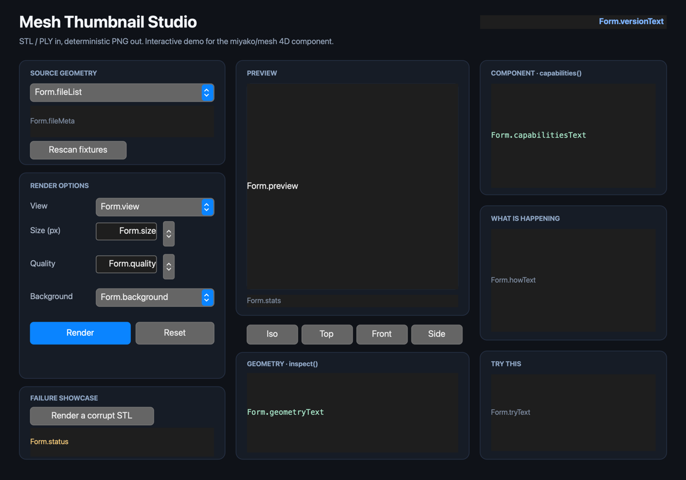

# mesh-demo

An interactive 4D form that puts [`miyako/mesh`](https://github.com/miyako/mesh) — the STL/PLY
thumbnail component wrapping the `mesh-thumb` Rust CLI — through its paces. Pick geometry,
change the camera, resize, swap the background, and watch a PNG materialise in under a
second; break it on purpose and read the structured error.



| Cube, iso | Ring point cloud, top | Triangle, front |
| --- | --- | --- |
|  |  |  |

The demo is deliberately small: one form class, one form, one startup method, and a
headless self-test. Everything else is the component doing the work.

---

## Quick start

1. Open `Project/mesh-demo.4DProject` with **4D 21** (built and tested on 21 R5; the
   project declares `compatibilityVersion` 2101).
2. 4D's Dependency manager reads `Project/Sources/dependencies.json` and fetches
   `miyako/mesh` `20.0.2` from its GitHub release, installing `Components/mesh.4dbase`.
3. Run the project. The form opens with the three bundled fixtures; press **Render** or
   any view button.

No dependency network? Install the component by hand instead: download `mesh.zip` from the
[miyako/mesh releases](https://github.com/miyako/mesh/releases), unzip it to
`Components/mesh.4dbase`, and remove `dependencies.json` (see
[chokepoint 4](#4-tool4d-cannot-resolve-a-github-declared-dependency)).

## Points of interest in the UI

- **Fixture dropdown** — `Form.fileList` is a Collection of names from
  `Folder("/RESOURCES/fixtures").files()`; the dropdown is an object data source, so the
  index is 0-based and `currentValue` is derived, not settable.
- **View buttons** — four buttons call the same `setView()` the dropdown does; the
  picture updates from the same temporary-file render path.
- **Size / quality steppers** — clamped 64–1024 and 1–8. The component itself validates
  quality range; sizes above 8192 are rejected by the CLI (`resource_limit_exceeded`),
  which the demo surfaces verbatim.
- **Background picker** — `#RRGGBB` or `transparent`, proving the option is passed
  through untouched.
- **Failure showcase** — renders `Resources/broken/truncated.stl` and
  `Resources/broken/not_a_mesh.bin` and prints the structured error envelope
  (`code`, `message`, `stage`); the last good preview is kept on screen.
- **Geometry card** — `inspect()` gives vertices/triangles/colours/normals and bounds
  without rendering, so the form can describe what it is about to draw.
- **Capabilities card** — `capabilities()` is called once at load: formats, views,
  quality ceiling, pixel limits, and whether a GPU backend is available.
- **Status line** — render result, elapsed milliseconds, output dimensions, and the
  on-disk PNG name. `mesh-thumb` is a real process; the timings are real.

## The component at a glance

```4d
var $thumb : cs.MeshPreview.Thumbnailer
$thumb:=cs.MeshPreview.Thumbnailer.new("macOS-universal")   // or "Windows-x64"

$result:=$thumb.render($input; $output; {size: 512; view: "iso"; background: "#20242B"; quality: 4})
// {ok; stdout; stderr; exitCode; value}  value = mesh-thumb's `result` object
// on failure: {ok: false; error: {code; message; path; stage; details}}

$info:=$thumb.inspect($input)      // geometry summary without a PNG
$caps:=$thumb.capabilities()       // formats, views, limits, gpu flag
$v:=$thumb.version()               // {ok; value: {name; version}}
```

The host sees the component class as `cs.MeshPreview.Thumbnailer` because the component
declares `component_classStore_name="MeshPreview"`; the prefix is not configurable from
the host side.

## How the demo is wired

| File | Role |
| --- | --- |
| `Project/Sources/Classes/StudioForm.4dm` | Form class: owns the `Thumbnailer`, file list, option values, preview picture and all display strings. Every control handler is a one-liner into this class. |
| `Project/Sources/Forms/Studio/form.4DForm` | 1000×700 static-layout form, `formClass: "StudioForm"`, `onLoad` only. |
| `Project/Sources/Forms/Studio/ObjectMethods/*.4dm` | 15 handlers, each calling `Form.render()`, `Form.setView()`, `Form.reset()` or `Form.demoError()`. |
| `Project/Sources/Methods/Start.4dm` | Menu bar, window, `DIALOG("Studio")`. Reuses an existing window when the startup method runs twice. |
| `Project/Sources/Methods/TestComponent.4dm` | Headless self-test: 43 assertions over the component and the form class. |
| `Project/Sources/styleSheets.css` | Dark studio palette used by the cards, badges, wells and mono text. |
| `Resources/fixtures`, `Resources/broken` | Three valid meshes (ASCII STL, PLY point cloud, binary STL) and two deliberate failures. |

## Headless self-test

`TestComponent` exercises the component directly and then drives `cs.StudioForm` without
any UI: `init()`, `setView()`, `demoError()`, `reset()`, and all four view renders for
each fixture.

```bash
# 4D + component: tool4d refuses to start while dependencies.json declares a GitHub
# dependency (see chokepoint 4). With a manual Components/mesh.4dbase install:
mv Project/Sources/dependencies.json /tmp/dependencies.json.bak
"/Applications/4D 21 R5 (100175)/tool4d.app/Contents/MacOS/tool4d" \
  --dataless --skip-onstartup \
  --startup-method TestComponent \
  --project "$PWD/Project/mesh-demo.4DProject" \
  --user-param /tmp/mesh-demo-report.json
mv /tmp/dependencies.json.bak Project/Sources/dependencies.json
```

Success prints `PASS 43 checks` on stdout and writes a JSON report with every check,
its detail string, and the binary target. The same run is a template for CI.

## Validation used while building this

```bash
tools/4dcatalog/xmllint --noout --nonet --dtdvalid .agents/schemas/4dcatalog/base.dtd \
  Project/Sources/catalog.4DCatalog
tools/4dform/boon -o simple .agents/schemas/4dform/formsSchema.json \
  Project/Sources/Forms/Studio/form.4DForm
tools/4dlsp/tool4d-lsp-stdio check-syntax --workspace Project/ --json
```

`xmllint` and `boon` exit 0. `check-syntax` reports only the component class as unknown
(chokepoint 1); every project method is otherwise clean.

---

## Chokepoints, fails and findings

### 1. `4dlsp check-syntax` cannot see component classes

Every use of `cs.MeshPreview.Thumbnailer` is reported as
`The class cs.MeshPreview is unknown` plus `function or property ... does not exist`.
The component is installed correctly: the same methods run, compile and pass 43 checks
under `tool4d`. The language server resolves classes from the workspace/project sources,
not from `Components/*.4dbase`, so component API calls are static-analysis blind spots.
Treat these diagnostics as expected noise, and prove the API at runtime instead.

### 2. `var $x : Longint` is rejected

`Longint` is not a valid `var` declaration type in 21 R5 (`Syntax error` in the method,
later a run-time/parse failure). Use an untyped `var $started` (or `Real`) for
`Milliseconds` arithmetic.

### 3. `4D.File.name` drops the extension

`$folder.files()` returns 4D.File objects whose `.name` is the display name **without**
extension. Building a list from `.name` and later calling `.file($name)` produces paths
like `/RESOURCES/fixtures/cube_ascii` and a CLI `io_error: No such file or directory`.
Use `.fullName` when the name has to round-trip into a path.

### 4. tool4d cannot resolve a GitHub-declared dependency

With `dependencies.json` present, `tool4d --dataless --skip-onstartup` prints
`PackageManager Dependency 'mesh' cannot be found` and aborts **before** compiling,
even when `Components/mesh.4dbase` is already installed and working. The standalone
runtime has no Dependency manager download path for `{"github": …}` entries.
Workaround for headless testing: temporarily move `dependencies.json` aside (the component
still loads from `Components/`), or point the test at a manually installed component.
Keep the declaration in the repo: the 4D IDE resolves it fine.

### 5. `Folder(fk temporary folder)` is Null under `--dataless`

The standard temp-folder idiom
`Folder(fk temporary folder).folder("mesh-demo")` returns **Null** in tool4d dataless
mode, and `Get 4D folder(Temporary folder; *)` returns an HFS-style path that
`Folder()` rejects as "a valid posix path was expected" without conversion.
Use `Folder(fk database folder).folder("output")` for demo artefacts: it exists in every
mode and makes the PNGs easy to find (and to gitignore).

### 6. Passing `formData` to `DIALOG` overrides the form class instance

`DIALOG("Studio"; $params; *)` with an empty object makes `Form` the *passed object*, not
the instance of `formClass: "StudioForm"`. `On Load` then fails on `Form.init()` with an
error dialog quoting the form method. Call `DIALOG("Studio")` with no data object when
the form has a form class. This also means the ready-made `dialog_screenshot` CLI chain
(passing `{}` as form data) is incompatible with form-class forms: the screenshot shows
an untouched form and the script blocks on the error dialog.

### 7. `multiline` is an enum, not a boolean

`"multiline": true` in a `.4DForm` fails `boon` schema validation. Valid values are
`"automatic"`, `"yes"`, `"no"`.

### 8. Object-based dropdown semantics

A dropdown backed by a Collection/`Form.fileList` object uses
`{"values": […], "index": n (0-based, read/write), "currentValue": … (read-only)}`.
Setting `currentValue` silently does nothing; write `index`. Plain text arrays
(`choiceList`) are simpler when values are static.

### 9. The component validates its own options

`quality: 99` returns `invalid_argument` from the wrapper before the CLI runs, while
`size: 70000` reaches `mesh-thumb` and returns `resource_limit_exceeded`. Both are the
same `ok: false` envelope; demo code should not assume a single error code for "bad input".

### 10. `version()` returns an object

`cs.MeshPreview.Thumbnailer.new(...).version()` is
`{ok; stdout; stderr; exitCode; value: {name; version}}` — not a string. Concatenating it
directly produces garbage or a type error; read `$v.value.version`.

### 11. Startup methods need the two-branch pattern

Calling `CALL WORKER(1; Current method name)` without a guard recurses. The canonical
pattern is: no parameters → look for an existing titled window (reuse it), otherwise
`CALL WORKER`; with parameters → build the UI and `DIALOG`. `QUIT 4D` as an early-out
in a method left the demo without an exit path; return instead.

### 12. 4D Collections are 0-based

Collection indexing starts at 0 while `length` counts elements, so
`For ($i; 1; $c.length)` reads one past the end and dies with
`Index in collection is out of range (-10713)` — while the first iteration silently
skips element 0. Iterate `0 .. $c.length-1`, or use `For each`.

### 13. Module fixture variety matters

A PLY `point_cloud` (12 vertices, colours) renders differently from triangle meshes and
is worth keeping in the fixture set: it exercises the `geometry.kind` union in the
inspect result, and it catches "treat every mesh as triangles" mistakes early.

## Repository layout

```
Project/           4D project (sources only; data, logs and caches are gitignored)
Resources/         fixture and deliberately broken meshes
docs/              form preview and sample renders used by this README
.agents/           skills submodule (miyako/skills dist) used for validation
```

## License

Demo code: MIT. `miyako/mesh` and `mesh-thumb`: MIT, © Keisuke Miyako.
